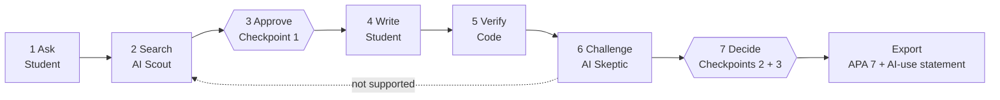
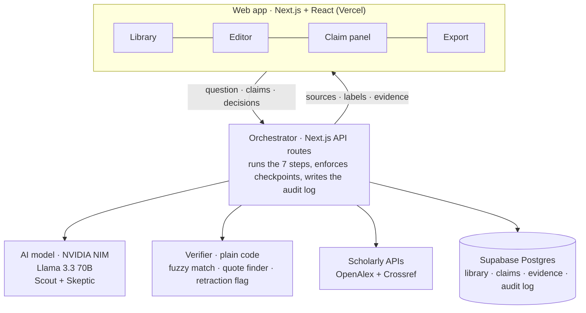

# ClaimTrace: project overview

**AI Club Hackathon 2026 · Team 6 · Neel, Mohit, Anand**

> **A real reference is not the same as a supporting reference.**
> ClaimTrace is a reference manager and AI research assistant that checks every citation three ways (does it **exist**, do its details **match**, and does the source actually **support** the claim), then shows the student the evidence before they decide.

| | |
|---|---|
| **Status** | Phase 1 (design). Ideation deck built; website not started |
| **Deck** | [pitch-deck/ClaimTrace_Team6_Pitch.pptx](pitch-deck/ClaimTrace_Team6_Pitch.pptx) (submission) · [pitch-deck/ClaimTrace_Team6_Pitch.html](pitch-deck/ClaimTrace_Team6_Pitch.html) (web version) |
| **Brief and rubric** | [DOCS/](DOCS/) |
| **Last updated** | 24 November 2026 |

---

## Contents

1. [The problem](#1-the-problem)
2. [Why we chose this problem](#2-why-we-chose-this-problem)
3. [Our solution](#3-our-solution-claimtrace)
4. [How we are approaching it](#4-how-we-are-approaching-it)
5. [Workflow](#5-workflow)
6. [Architecture](#6-architecture)
7. [Tool stack](#7-tool-stack)
8. [Guardrails](#8-guardrails)
9. [Ethical considerations](#9-ethical-considerations)
10. [Governance](#10-governance)
11. [MVP scope and demo](#11-mvp-scope-and-demo)
12. [Preparing for the day-of requirements](#12-preparing-for-the-day-of-requirements)
13. [Known limitations and risks](#13-known-limitations-and-risks)
14. [Timeline, deliverables and scoring](#14-timeline-deliverables-and-scoring)
15. [Decision log](#15-decision-log)
16. [References](#16-references)

---

## 1. The problem

### The brief

The hackathon asks every team for the same thing: a website that helps researchers **find, organise and cite sources** like a reference manager (Zotero, Mendeley, EndNote), and also acts as an **AI research assistant**, without the invented references AI is known for. A student must be able to trust that **every reference is real and every claim can be traced back to its source**, and must stay in charge of the final decisions.

### What goes wrong today

AI is fast, but it fails in ways a polished assignment can hide. The student is responsible for every one of these errors:

| Failure | Example | How often (published evidence) |
|---|---|---|
| **Invented reference** | A DOI or paper that does not exist | 55% of GPT‑3.5 references and 18% of GPT‑4 references were fabricated (Walters & Wilder, 2023) |
| **Wrong details on a real reference** | Real paper, wrong author, year or title | 43% of GPT‑3.5's real references and 24% of GPT‑4's had substantive errors (same study) |
| **Real reference, wrong claim** | The paper exists but doesn't say what the sentence claims, or says something narrower | The hardest to spot; no mainstream tool checks it |
| **Retracted source** | Citing a paper that has been withdrawn | Only 5.4% of citations made after a retraction mentioned it (722 of 13,252; Hsiao & Schneider, 2021) |

> The 2023 figures describe specific older models. They show the failure types are real, not how today's models perform.

### The gap in existing tools

| Tool | What it does well | What it leaves to the student |
|---|---|---|
| Zotero, Mendeley, EndNote | Save, organise, tag, format APA 7 | Does the source support my sentence? |
| ResearchRabbit | Discovers related papers and connections | Is my claim faithful to the paper? |
| SciSpace / AI assistants | Explain and summarise papers fast | Can invent or distort; summaries drop caveats |
| Citation formatters | Correct formatting | Formatting says nothing about accuracy |

**The gap:** reference managers organise and format. AI tools find and summarise. **Nothing checks whether the source supports the sentence.** ClaimTrace does.

---

## 2. Why we chose this problem

### It came out of research, not a feature list

Before choosing an idea, we ran a structured discovery process (Phase 0: rules; Phase 1: problem research). We mapped the research workflow stage by stage, from defining the question through to final verification, and ranked the problems we found:

| Rank | Research problem | Severity | Frequency | Consequence | Feasibility |
|---|---|---|---|---|---|
| **1** | **The claim does not match the cited evidence** | High | High | High | Medium |
| 2 | Synthesising conflicting research | High | High | High | Low |
| 3 | Incomplete or biased literature discovery | High | High | High | Low |
| 4 | AI-generated fabricated or inaccurate references | High | Medium | High | High |
| 5 | Losing context during extraction and writing | High | High | High | Medium |
| 6 | Missing retractions and corrections | Medium | Medium | High | Medium |
| 7 | Reference organisation and formatting | Low | High | Medium | High |

ClaimTrace targets **problem #1** and builds in **#4** and **#6** along the way. Problems #2 and #3 matter just as much, but we judged them too hard to demonstrate reliably in a hackathon MVP.

### Five findings that shaped the product

1. **A source existing does not make it relevant.** A real paper can be cited for something it never establishes.
2. **Credibility depends on the claim.** A study can be excellent for a narrow question and wrong for a broad one, so we give no universal "credibility score".
3. **Bibliographic checks and evidence checks are different problems.** Existence and metadata checks can be done with plain code. Whether a source supports a claim needs reading and judgement.
4. **AI errors happen at many stages:** discovery, summarising, interpretation and citation, not only invented references.
5. **The underlying human skill is research judgement.** The tool should support it, not replace it.

### Why this helps us stand out

Every team gets the same brief, and its own hints (Crossref/OpenAlex checks, trust labels) push teams towards the same build: **"check the reference exists, then format it."** We go one step further than most teams are likely to: **does the source actually say what the claim says?** That step:

- matches the brief's own words: "every claim can be traced back to its source"
- scores directly on the **"Honesty and verification in action"** criterion (10 points), with a visible check, not just a green badge
- is hard to dismiss as a chatbot wrapper, because most of the checking is deterministic code with evidence shown on screen

---

## 3. Our solution: ClaimTrace

### Three checks on every citation

| Check | Question | How it's answered |
|---|---|---|
| ✅ **EXISTS** | Is it a real record? | The DOI or OpenAlex ID resolves in Crossref / OpenAlex (code) |
| ✅ **MATCHES** | Do the authors, title and year match the record? | Fuzzy metadata comparison (code) |
| ✅ **SUPPORTS** | Does the source actually say what the claim says? | The Skeptic agent finds the exact source sentence; code confirms that sentence really exists in the source text |

There is also a **retraction check**: retracted papers are flagged red.

### Trust labels on every claim

| Label | Colour | Meaning |
|---|---|---|
| **Verified** | 🟢 mint | Exists, matches, and the supporting sentence was found in the source |
| **Overreach** | 🟠 amber | The source is related, but the claim goes beyond it (e.g. "causes" when the study shows an association) |
| **Unchecked** | 🔵 sky | The reference is real, but there is no readable text to check the claim against |
| **AI reasoning** | 🟣 violet | The AI's own inference, not backed by a source |
| **Not found / Retracted** | 🔴 rose | No matching record exists, or the paper has been withdrawn |

**"Verified" means "we found the sentence", not "this is true".** The label is honest about what was checked.

### Illustrative example (fictional paper)

> **Claim in draft:** *"Social media use causes anxiety in teenagers" (Lee & Park, 2021)*
>
> ✅ EXISTS · ✅ MATCHES · ✅ NOT RETRACTED
>
> ⚠️ **OVERREACH**. Source says: *"Among 312 students at two schools, heavy use was associated with higher anxiety scores."* The claim says "causes" and stretches the finding to all teenagers.
>
> **[Edit claim]** · **[Find better source]** · **[Accept anyway]** *(logged)*

---

## 4. How we are approaching it

### Core principle

> **AI suggests. Code checks. The student decides.**

### Working principles

| Principle | What it means in practice |
|---|---|
| **Problem before product** | We chose the problem from research, then designed features to solve it |
| **Evidence before claims** | We never claim a verification capability we cannot demonstrate live |
| **Demo before complexity** | One complete journey that works beats many features that don't (the rubric says the same) |
| **Deterministic where possible** | Existence, metadata, retraction, quote presence and export gating are plain code. The AI is used only where language understanding is needed |
| **The AI has to earn its place** | Two narrow agents with distinct jobs, because each does a different kind of reasoning; no agent swarm for show |
| **Honest by default** | When something can't be checked, we say "Unchecked" or "Not found", never a best guess |
| **Modular for change** | Every check is its own function, so the 1:15 PM requirements can be absorbed without a rewrite |

### Process we are following

```
Understand → Investigate → Discover → Ideate → Attack → Select → Design → Build → Stress-test → Demo
   (Phase 0–1 done)            (concept selected)        (deck done)      (next)
```

Each stage has a decision gate. Approved decisions are tracked separately from brainstormed ideas in the [decision log](#15-decision-log).

---

## 5. Workflow

Seven steps, two narrow AI agents, one code checker and three human checkpoints.

| # | Step | Who | What happens | Control / check |
|---|---|---|---|---|
| 1 | **Ask** | Student | Enters a research question and picks a citation style (APA 7 by default) | |
| 2 | **Search** | 🤖 Scout agent | Turns the question into a search plan and queries OpenAlex and Crossref. **Returns real records only** | |
| 3 | **Approve** | Student | Approves the plan, picks sources and files them with folders, tags and notes | ✋ **Checkpoint 1** |
| 4 | **Write** | Student | Writes the draft and links each claim to a saved source | |
| 5 | **Verify** | ⚙️ Code (no AI) | Checks the record exists, the details match and it isn't retracted | 🛡️ **Check** |
| 6 | **Challenge** | 🤖 Skeptic agent | Finds the exact source sentence behind each claim and flags overreach; code re-checks that the sentence exists | 🛡️ **Check** |
| 7 | **Decide** | Student | Accepts, edits or replaces each flagged claim, then exports | ✋ **Checkpoints 2 + 3** |

**Feedback loop:** if a claim isn't supported, Scout suggests better sources and the student goes back round the loop (step 6 → step 2). Research isn't linear, so the workflow isn't either.



**Where the student is in control:** ① approve the search plan and sources, ② resolve every flag, ③ sign off before export. Nothing is saved, changed or exported without a click.

**Why the agents stay narrow:** Scout can only search; Skeptic can only challenge. Neither can approve a source, write a reference or edit the draft.

---

## 6. Architecture

One web app, one AI provider, two free scholarly databases and one database. **The AI runs in only two places**; every other check is plain code.



### Components

| Component | Responsibility |
|---|---|
| **Web app** | Library (folders, tags, notes) · Editor (draft with linked claims) · Claim panel (labels, evidence, actions) · Export |
| **Orchestrator** | Runs the 7 steps in order, enforces the 3 checkpoints, writes every action to the audit log |
| **AI model** (NVIDIA NIM) | **Scout:** search plans. **Skeptic:** evidence sentence plus support verdict. JSON output, temperature 0 |
| **Verifier** (code) | Title/author/year matching, quote-in-source check, retraction flag, export gate |
| **Scholarly APIs** | OpenAlex and Crossref: real records, DOIs, authors, abstracts, open-access links, retraction data |
| **Database** | Library, folders, tags, claims, evidence snippets and the audit log |

### Data flow

1. Question → Scout (NIM) → search terms
2. Terms → OpenAlex / Crossref → real records
3. Student approves → saved to the library
4. Claim + source text → Verifier + Skeptic → label and evidence sentence
5. Student decision → audit log → APA 7 export

### Failure handling

| If… | Then… |
|---|---|
| The AI is rate-limited or offline | Claims show **Unchecked**, never a fake **Verified**; existence and metadata checks still run, because they are code |
| No abstract or open text is available | **Unchecked** ("real, but no text to check") |
| No database match | **Not found** |
| The AI returns a quote that isn't in the source | The quote is rejected and the claim is not marked supported |
| A live AI call isn't possible in the demo | The output is clearly labelled **Sample** |

---

## 7. Tool stack

Everything is free or free-tier. No paid APIs, enterprise databases or proprietary datasets.

| Layer | Tool | Why we chose it | Status |
|---|---|---|---|
| Front end | **Next.js + React** | One codebase for UI and API routes; fast to build | Proposed |
| Hosting | **Vercel** | Free tier, one-command deploys, gives a live link for judges | Proposed |
| Back end / orchestration | **Next.js API routes** (TypeScript) | No separate server to run | Proposed |
| AI model | **NVIDIA NIM API** · `meta/llama-3.3-70b-instruct` | Team has NVIDIA API keys; OpenAI-compatible endpoint (`integrate.api.nvidia.com/v1`) | Proposed |
| Scholarly data | **OpenAlex API** | Free, open (CC0), search, abstracts, open-access links, `is_retracted` flag | Approved (core to concept) |
| Scholarly data | **Crossref REST API** | Authoritative DOI metadata; includes Retraction Watch data | Approved (core to concept) |
| Database | **Supabase (Postgres)** | Free tier, row-level security so each student sees only their own data | Proposed |
| Citation export | **citation-js** (CSL) | APA 7, BibTeX and RIS from the same record | Proposed |
| Fuzzy matching | String-similarity library (e.g. token-set ratio / Jaro-Winkler) | Deterministic title and author matching | Proposed |
| Pitch deck | **pptxgenjs**, **lucide** icons, **Pillow** (animated background) | One spec builds both the PPTX and the HTML deck | Done |
| Planning / build assistant | Claude, ChatGPT | Planning and coding help; main prompts go in the required prompt log | In use |

**NVIDIA free-tier constraint:** around **40 requests per minute**, according to developers on NVIDIA's forums (not official documentation). This is why the AI is used in only two steps, why results are cached per claim and source, and why the app degrades to "Unchecked" rather than failing.

---

## 8. Guardrails

Six specific mechanisms that keep the website honest:

| # | Guardrail | Mechanism | Type |
|---|---|---|---|
| 01 | **Retrieval-only references** | The AI can't write a citation. Each one needs a DOI or OpenAlex ID returned by the database; anything else is rejected | Code |
| 02 | **Metadata must match** | Title at least 90% similar, plus first author and year (±1), or it is marked "Mismatch" | Code |
| 03 | **Quote or it didn't happen** | "Supported" needs the exact source sentence, and code confirms that sentence is really in the source text | AI + code |
| 04 | **Scope check** | Flags overreach such as "causes", "all" or "proves" when the study shows a link in one small group | AI + keyword rules |
| 05 | **Honest "Not found"** | No matching record means "Not found". No readable text means "Unchecked". Never a best guess | Code |
| 06 | **Retraction + export gate** | Retracted papers turn red. Export stays locked until every red flag is fixed or knowingly overridden (overrides are logged) | Code |

Supporting rules: the AI gets structured JSON prompts at temperature 0; every AI output is labelled; AI-suggested text stays **"AI reasoning"** until it is linked to a verified source.

---

## 9. Ethical considerations

Every risk is handled by a specific feature, not by a promise.

| Risk | Why it matters | How ClaimTrace responds |
|---|---|---|
| **Invented citations** | AI writes convincing references that don't exist | Retrieval-only references: every citation comes from OpenAlex or Crossref, and its details must match the record |
| **Misrepresented research** | A real paper is cited for something it never says | The Skeptic shows the exact source sentence beside the claim and flags overreach; the student makes the call |
| **Plagiarism and patchwriting** | Wording is copied too closely from the source | Quotes need quote marks and a page number; sentences that reuse long runs of source wording are flagged to quote or rewrite |
| **Privacy** | Drafts and research topics are personal | Only the claim and source text go to the AI, never names, emails or whole drafts. Students can delete their library and logs at any time |
| **Biased or narrow sources** | Databases over-represent some regions, languages and journals | A source-mix view shows years, countries and open-access share. No single "credibility score": fit is judged claim by claim |
| **Over-reliance on AI** | Students accept AI output without thinking it through | The AI never decides: three checkpoints, every flag needs a click, and "Verified" means "sentence found", not "this is true" |

---

## 10. Governance

| Area | Commitment |
|---|---|
| **Accountability** | The student is the author of record and makes every final decision. ClaimTrace gives evidence, not verdicts, and shows its known limits in the app. Every AI output and human decision is logged with time, model and action. Team 6 owns the system's behaviour and fixes reported errors |
| **AI disclosure** | Inline labels separate AI reasoning from verified sources. Every export includes an auto-generated **AI-use statement** (which steps used AI, the model, the date, and what the student changed). Any demo output that isn't a live AI call is labelled "Sample" |
| **Policies followed** | SP Jain academic integrity and AI-use policy · APA 7, including APA guidance on citing generative AI · UNESCO *Guidance for Generative AI in Education and Research* (2023) · data minimisation in line with GDPR principles · OpenAlex, Crossref and NVIDIA terms of use |

**Sample AI-use statement (generated on export):**

> *"I used ClaimTrace (Llama 3.3 70B via NVIDIA NIM) on 26 Nov 2026 to plan literature searches and to check whether my 14 cited sources support my claims. It flagged 3 claims: I rewrote 2 and replaced 1 source. All final wording and decisions are my own."*

---

## 11. MVP scope and demo

The rubric is explicit: **one core journey that works well beats many features that don't.**

### In scope for the MVP

- [ ] Research question → Scout search plan → OpenAlex/Crossref results
- [ ] Approve sources → library with folders, tags and notes
- [ ] Draft editor where each claim links to a saved source
- [ ] Verifier: exists, metadata match, retraction flag
- [ ] Skeptic: evidence sentence plus Supported / Overreach / Unchecked, with a code re-check of the quote
- [ ] Claim panel with trust labels and Accept / Edit / Find better source actions
- [ ] Export gate, APA 7 reference list and AI-use statement
- [ ] Audit log

### Out of scope (deliberately)

- Cross-paper contradiction analysis (very hard to demo reliably)
- Full-text PDF parsing of paywalled papers
- Chatbot-style free conversation
- Multi-user collaboration or a supervisor dashboard
- A universal "credibility score"

### Demo storyline (draft)

1. Ask a real research question and approve Scout's plan and sources.
2. Paste a draft containing four planted claims:
   - one **supported** claim → Verified
   - one **overreaching** claim → Overreach, with the source sentence shown
   - one **fabricated reference** → Not found
   - one **retracted paper** → red flag
3. Fix the flags, watch export unlock, and download the APA 7 list plus the AI-use statement.
4. Show the audit log.

---

## 12. Preparing for the day-of requirements

At **1:15 PM on 26 November** the organisers will add new requirements, and there are **90 minutes** to adapt. Judges score how well we adapt while still following this design.

- **Each check is its own function.** A new rule, source or citation style plugs in without a rewrite.
- **Citation styles are CSL files.** Adding Harvard, MLA or IEEE is a config change.
- **The source connectors are swappable,** so another free API (e.g. Semantic Scholar) can be added beside OpenAlex and Crossref.
- **Labels and the AI-use statement are templates,** so new disclosure or policy wording is a text change.
- **The working first version must be ready before the event.** The 90 minutes are for adapting, not building.

---

## 13. Known limitations and risks

We would rather state these openly than have the judges find them.

| Limitation / risk | Impact | Mitigation |
|---|---|---|
| OpenAlex has abstracts for only about 45–60% of works (fewer for older papers) | Some claims can't be checked for support | Honest **Unchecked** label; open-access full text where OpenAlex links it |
| Paywalled full text isn't accessible | Support checks rely on the abstract | Label what was checked ("abstract only") |
| The LLM's support judgement can be wrong | False Verified or false Overreach | The quote must exist in the source (code check); the student sees the evidence and decides |
| NVIDIA free tier is about 40 requests/min (community-reported) | Slowdowns during the demo | Two AI steps only, caching, graceful "Unchecked", pre-warmed demo data |
| OpenAlex's `is_retracted` field had a misclassification bug in early 2024 (since fixed) | Possible false retraction flags | Cross-check with Crossref retraction data before flagging red |
| Fuzzy metadata matching can produce false matches or misses | Wrong Exists/Matches result | Conservative thresholds; show the matched record so the student can compare |
| Database coverage favours some languages and regions | Biased discovery | Source-mix view; coverage limits disclosed |

---

## 14. Timeline, deliverables and scoring

### Timeline

| When | What |
|---|---|
| 24–26 Nov | Phase 1: design and build the first working version |
| **Thu 26 Nov, 9:00 AM** | **Ideation deck due** (PowerPoint, max 6 slides; late decks are not scored) |
| Thu 26 Nov, 1:15 PM | Additional requirements announced |
| 1:15 PM to 3:00 PM | 90-minute adaptation window |
| **Thu 26 Nov, 3:00 PM** | **Phase 2 submission locks** |

### Deliverables

| Phase | Deliverable | Status |
|---|---|---|
| 1 | Ideation deck (≤ 6 slides, PPTX) | ✅ Built: [pitch-deck/ClaimTrace_Team6_Pitch.pptx](pitch-deck/ClaimTrace_Team6_Pitch.pptx) |
| 2 | GitHub repository (accessible to organisers) | ⏳ |
| 2 | Prompt log: main AI prompts in the order used | ⏳ Start recording now |
| 2 | Live website link (or a declared local demo) | ⏳ |

Submit on the hackathon platform: <https://ai-hackathon-tau-green.vercel.app/> (sign in with your SP Jain email and the team code).

### How we score (100 points)

**Phase 1: ideation deck (30)**

| Criterion | Points | Where we cover it |
|---|---|---|
| Workflow | 8 | Slide 2 · [Section 5](#5-workflow) |
| Architecture | 6 | Slide 3 · [Section 6](#6-architecture) |
| Ethical considerations | 5 | Slide 5 · [Section 9](#9-ethical-considerations) |
| Governance | 5 | Slide 6 · [Section 10](#10-governance) |
| Guardrails | 6 | Slide 4 · [Section 8](#8-guardrails) |

**AI quiz (5):** points by team ranking.

**Phase 2: website and presentation (65)**

| Criterion | Points | Our plan |
|---|---|---|
| Working MVP | 15 | One end-to-end journey (Section 11) |
| Research and citation features | 12 | Search, library, linked claims, APA 7 export |
| Honesty and verification in action | 10 | Live Verifier + Skeptic with evidence on screen |
| Day-of requirements | 8 | Modular checks (Section 12) |
| User experience | 8 | Trust labels and one-click actions; usable without instructions |
| Presentation and Q&A | 12 | Every member presents a part (to be assigned) |

---

## 15. Decision log

Approved decisions are kept separate from proposals. **Nothing here changes without the team agreeing.**

### ✅ Approved

| Date | Decision | Reason |
|---|---|---|
| 24 Nov | Problem focus: **claim–evidence mismatch** (plus existence, metadata and retraction checks) | Ranked #1 in Phase 1 research; distinctive; demonstrable |
| 24 Nov | Product name: **ClaimTrace** | Plain and descriptive: every claim traced to its source |
| 24 Nov | Team: **Team 6**, Neel, Mohit, Anand | — |
| 24 Nov | AI used in only two places (Scout, Skeptic); all other checks deterministic | Reliability, rate limits, honesty |
| 24 Nov | Data sources: OpenAlex + Crossref | Free, open, named in the brief |
| 24 Nov | Ideation deck structure: 6 slides mapped to the 5 rubric areas | Rubric |

### 🟡 Proposed: needs team confirmation

| Item | Current proposal | Open question |
|---|---|---|
| Front-end stack | Next.js + React on Vercel | Is the team comfortable with it? |
| Database | Supabase Postgres | Or local/browser storage for a simpler demo? |
| AI model | Llama 3.3 70B via NVIDIA NIM | Check the team's keys work with this model (some users report 402 errors) |
| Matching thresholds | Title ≥ 90%, year ±1 | Tune on real test data |
| Patchwriting rule | Flag long runs of shared source wording (e.g. 8+ words) | Choose the threshold |
| Policy name | "SP Jain academic integrity and AI-use policy" | Confirm the exact policy title |
| Presentation roles | — | Who presents which part? |

### 💭 Ideas parked (not requirements)

- Cross-paper contradiction explainer
- Citation-dependency detection (several sources relying on one original study)
- Research uncertainty map
- Browser extension for one-click saving

---

## 16. References

- Walters, W. H., & Wilder, E. I. (2023). Fabrication and errors in the bibliographic citations generated by ChatGPT. *Scientific Reports, 13*, 14045. <https://pmc.ncbi.nlm.nih.gov/articles/PMC10484980>
- Hsiao, T.-K., & Schneider, J. (2021). Continued use of retracted papers: Temporal trends in citations and (lack of) awareness of retractions shown in citation contexts in biomedicine. *Quantitative Science Studies*. <https://pmc.ncbi.nlm.nih.gov/articles/PMC9520488/>
- OpenAlex. Work object documentation (`is_retracted`, `abstract_inverted_index`). <https://docs.openalex.org/api-entities/works/work-object>
- Crossref (2023). Retraction Watch retractions now in the Crossref API. <https://www.crossref.org/blog/retraction-watch-retractions-now-in-the-crossref-api/>
- (Non-)retracted academic papers in OpenAlex (2024). <https://arxiv.org/abs/2403.13339>
- NVIDIA Developer Forums: NIM API rate-limit discussions (community-reported 40 RPM). <https://forums.developer.nvidia.com/t/api-rate-limit-increase-is-not-granted-by-requesting-it-here/368420>
- AI Club Hackathon 2026: Problem Statement; Submission Guidelines and Rubrics ([DOCS/](DOCS/))
