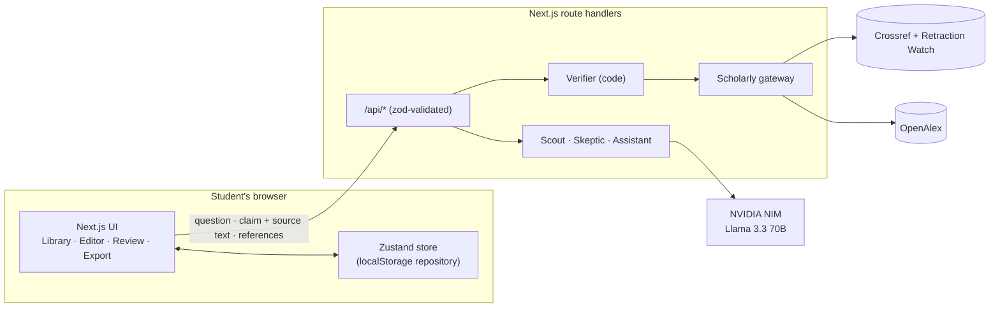

# ClaimTrace architecture

## Principles

1. **Deterministic first.** Everything that can be decided by code is decided by code: existence, metadata matching, retraction status, quote presence, patchwriting, the export gate. The AI is used only where language understanding is needed (planning a search, judging support, explaining a source).
2. **The AI is never trusted on facts.** It cannot write references (search returns database records), and any sentence it offers as evidence is rejected unless code finds it in the source.
3. **Honest degradation.** If the AI is offline, rate-limited or returns malformed output, claims show **Unchecked**, never Verified.
4. **The student decides.** Three checkpoints; every flag needs an explicit decision; every AI output and decision is logged.
5. **Privacy by design.** No accounts and no server database: research data stays in the browser. Only the single claim and its source text are sent for a check.

## System context



## Layers

| Layer | Folder | Responsibility | Depends on |
|---|---|---|---|
| Domain core | `src/core` | Types, label vocabulary, matching rules, evidence ranking, quote check, scope rules, claim extraction, export gate, AI-use statement, source mix. Pure functions, unit-tested. | nothing |
| Server adapters | `src/server` | Environment config, HTTP with timeouts/retries/cache, rate limiting, Crossref and OpenAlex connectors (one `SourceConnector` interface), the Verifier, the AI client and the three agents. Marked `server-only`. | core |
| API | `src/app/api` | Thin route handlers: validate with the shared zod contracts (`core/api-schemas.ts`), call a service, return JSON. Per-client rate limit; no internal errors leak. | server, core |
| Client data | `src/lib` | Typed API client, the persisted store (repository boundary), application services (`actions.ts`: one function per workflow step, always writing the audit log), derived-state hooks. | core |
| UI | `src/components`, `src/app` | Pages and components. No business rules: they call actions and render core results. | lib, core |

## API

| Route | Purpose | AI? |
|---|---|---|
| `GET /api/health` | AI configured? model name | no |
| `POST /api/scout/plan` | Research question to search plan (code fallback) | yes |
| `POST /api/sources/search` | Run an approved plan in OpenAlex, merge queries by reciprocal rank | no |
| `POST /api/sources/verify` | Verify one reference (DOI, structured or pasted) | no |
| `POST /api/sources/verify-batch` | Verify a pasted reference list (up to 40, three at a time) | no |
| `POST /api/claims/check` | Skeptic: verdict plus a code-verified evidence sentence | yes |
| `POST /api/assistant/summary` | Evidence-linked explanation of a source | yes |

## The Verifier

```
reference ─┬─ has DOI ──► Crossref + OpenAlex by DOI ──► compare title / first author / year
           └─ no DOI ───► Crossref bibliographic + OpenAlex title search ──► best candidate
                                    │
            retraction: Crossref "updated-by" (Retraction Watch) + OpenAlex is_retracted
                                    ▼
         verified · close_match (confirm?) · not_found · retracted · student_added
```

Thresholds live in `src/core/config.ts` and are shown in the app (Settings). Notable rules: a real DOI on a different title is **Not found**; years may differ by one; shared title words never make a close match on their own (the authors, or for a near-identical title the year, must agree); the journal's own name is ignored when matching; retraction notices never win over the original paper.

## The Skeptic

1. Code splits the source text into sentences and ranks candidates (BM25).
2. Code applies scope rules (causal wording for associations, extra certainty, generalising from a sample) and passes them to the model as hints, never as verdicts.
3. The model returns `{verdict, sentence, quote, explanation}` as JSON at temperature 0; the reply is schema-validated (one repair attempt).
4. Code confirms the quoted sentence exists in the source (≥95% identical). If not, the claim is **Unchecked** (`quote_not_in_source`).
5. Code also flags patchwriting (8+ consecutive shared words outside quotes) and checks direct quotations word for word.

Source text is fenced as data in the prompt, and the quote re-check means injected instructions cannot produce a Verified label.

## State and persistence

The store (`src/lib/store.ts`) holds projects, sources, folders, claim checks (keyed by a stable hash of claim text and cited sources), decisions and an append-only audit log, persisted to `localStorage` (versioned). Pages render after the saved data loads (`instant = false` on workspace routes). Claims are derived, not stored: they are extracted from the editor document whenever it changes, so editing a sentence automatically invalidates its old check. Swapping to a server database means replacing the store's `storage` option.

## Performance and reliability

- Upstream GETs are cached in memory (6 h); AI replies are cached by prompt hash (12 h).
- A token bucket keeps AI calls under the provider's per-minute quota; a per-client window limiter protects the shared budget.
- All upstream calls have timeouts and retry with backoff on 429/5xx.
- citation-js and the CSL styles load only on pages that format references.

## Adapting to new requirements on the day

| Likely request | Where to change |
|---|---|
| Another citation style | Add a CSL file to `src/lib/csl/styles.ts` and an entry in `CITATION_STYLES` (`src/core/model.ts`). |
| Another database (PubMed, arXiv, Semantic Scholar) | Implement `SourceConnector` (`src/server/sources/types.ts`) and register it in `src/server/sources/index.ts`. |
| A different model or provider | `AI_BASE_URL` and `AI_MODEL` environment variables. |
| New label or rule | `src/core/labels.ts`, `src/core/config.ts`, `src/core/workflow/*` (each with tests). |
| New disclosure wording | `src/core/workflow/statement.ts` (template). |
| Supervisor view | The audit log already exports JSON/CSV and the integrity report prints. |

## Testing

- `npm test`: unit tests for the core rules (matching, sentences, evidence ranking, quote check, scope rules, claim extraction, labels, gate, statement, source mix).
- `npm run eval`: live Verifier accuracy on labelled development and held-out sets.
- End-to-end: the full journey was exercised in a headless browser (demo load, search, library, editor citation insert, all claim checks, export gate).
