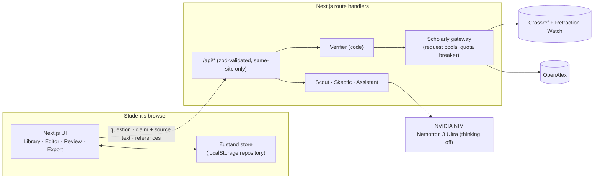

# ClaimTrace architecture

## Principles

1. **Deterministic first.** Everything that can be decided by code is decided by code: existence, metadata matching, retraction status, whether evidence is a real sentence about the claim, patchwriting, the export gate. The AI is used only where language understanding is needed (planning a search, judging support, explaining a source).
2. **The AI is never trusted on facts.** It cannot write references (search returns database records), and any sentence it offers as evidence is rejected unless code finds it in the source as a whole sentence that is about the claim.
3. **Honest degradation.** If the AI is offline, rate-limited or returns malformed output, claims show **Unchecked**, never Supported. If a database does not answer, a reference shows **Not yet verified** (couldn't check), never Not found or Verified. Sample results (demo only) are always labelled Sample.
4. **The student decides.** Three checkpoints; every flag needs an explicit decision; every AI output and decision is logged.
5. **Privacy by design.** No accounts and no server database: research data stays in the browser. Only the single claim and its source text are sent for a check.

## System context



## Layers

| Layer | Folder | Responsibility | Depends on |
|---|---|---|---|
| Domain core | `src/core` | Types, label vocabulary, matching and identity rules, evidence ranking, quote check, the Skeptic's evidence rules (`evidence/judge.ts`), scope rules, negation, claim extraction, export gate, AI-use statement, source mix, record helpers. Pure functions, unit-tested. | nothing |
| Server adapters | `src/server` | Environment config; HTTP with timeouts, retries, cache, per-service request pools and a quota breaker; rate limiting; Crossref and OpenAlex connectors (one `SourceConnector` interface); the Verifier; the AI client and the three AI roles. Marked `server-only`. | core |
| API | `src/app/api` | Thin route handlers: validate with the shared zod contracts (`core/api-schemas.ts`), call a service, return JSON. Cross-site requests refused, body size capped while reading, per-client rate limits; no internal errors leak. | server, core |
| Client data | `src/lib` | Typed API client, the persisted store (repository boundary), application services (`actions.ts`: one function per workflow step, always writing the audit log), derived-state hooks, demo samples, project files. | core |
| UI | `src/components`, `src/app` | Pages and components. No business rules: they call actions and render core results. A Previous / Next bar (`components/app/step-nav.tsx`) follows the workflow order. | lib, core |

## Orchestration

The deck's "orchestrator" has two halves:

- **In the browser**, the application services in `src/lib/actions.ts` run each workflow step, and `src/core/workflow/gate.ts` decides what still blocks export (checkpoints 2 and 3). Checkpoint 1 is the UI itself: nothing enters the library without the student's click. Every step writes to the audit log, which is stored with the student's data.
- **On the server**, the API routes call the databases and the AI. The keys live only in the server's environment. The server stores no projects: only short-lived caches and rate-limit counters (see Performance and reliability).

The workflow runs in the browser because the data does: the checkpoints and the log stay next to what they protect.

## API

| Route | Purpose | AI? |
|---|---|---|
| `GET /api/health` | AI configured? model; OpenAlex key and contact email set? databases refusing requests? | no |
| `POST /api/scout/plan` | Research question to search plan (code fallback) | yes |
| `POST /api/sources/search` | Run an approved plan in OpenAlex, merge queries by reciprocal rank | no |
| `POST /api/sources/verify` | Verify one reference (DOI, structured or pasted) | no |
| `POST /api/sources/verify-batch` | Verify part of a pasted reference list (the app sends four per request; 45 s time budget) | no |
| `POST /api/claims/check` | Skeptic: verdict plus a code-checked evidence sentence | yes |
| `POST /api/assistant/summary` | Evidence-linked explanation of a source | yes |

## The Verifier

```
reference ─┬─ has DOI ──► Crossref + OpenAlex by DOI ──► compare title / first author / year
           └─ no DOI ───► Crossref bibliographic + OpenAlex title search ──► best candidate
                                    │
            retraction: Crossref "updated-by" (Retraction Watch) + OpenAlex is_retracted
                                    ▼
   verified · close_match (compare, confirm) · not_found · retracted · unavailable · student_added
```

Thresholds live in `src/core/config.ts` and are shown in the app (Settings). Notable rules: a real DOI on a different title is **Not found**; years may differ by one; shared title words never make a close match on their own, for pasted references and BibTeX/RIS entries alike (a DOI, a matching author, or for a near-identical title the year, must agree); the journal's own name is ignored when matching; retraction notices never win over the original paper.

**Not found vs Not yet verified.** Lookups report which databases failed. "Not found" is only returned when the databases answered; if one failed and the other has no match, the result is `unavailable` (labelled "Not yet verified": the check could not finish), which the export gate treats like Unchecked. A failed re-check keeps the earlier result. If one database fails but the other confirms the paper, the reference is verified and the retraction step says which database was not checked.

## The Skeptic

The code half lives in `src/core/evidence/judge.ts` (pure, shared with the scripts and tests).

1. Code splits the source text into sentences (the first 80; the check says when text was left out) and ranks candidates (BM25, with interchangeable findings words such as teen/adolescent folded together).
2. Code applies scope rules (causal wording for associations, extra certainty, generalising from a sample, an effect size the source does not state, a different population, an opposite direction) and passes them to the model as hints, never as verdicts.
3. The model returns `{verdict, sentence, quote, explanation}` as JSON at temperature 0; the reply is schema-validated (one repair attempt).
4. Code accepts the evidence only if it is in the source (≥95% identical), is a whole sentence (≥60% of it, or a substantial part of the sentence the model named), and is about the claim (≥25% of the claim's key terms, or code's own top-ranked sentence). Otherwise the claim is **Unchecked** (`quote_not_in_source` or `evidence_not_relevant`).
5. Code also flags patchwriting (8+ consecutive shared words outside quotes) and checks direct quotations word for word.
6. A claim supported by text the student pasted is labelled **Supported · your text** and needs an acknowledgement; the report and the AI-use statement disclose it, and code warns when pasted text shares few terms with the paper.

Source text is fenced as data in the prompt, and the evidence rules mean injected instructions cannot produce a Supported label.

## State and persistence

The store (`src/lib/store.ts`) holds projects, sources, folders, claim checks (keyed by a stable hash of claim text and cited sources), decisions and an append-only audit log, persisted to `localStorage` (versioned). Pages render after the saved data loads (`instant = false` on workspace routes). Claims are derived, not stored: they are extracted from the editor document whenever it changes, so editing a sentence automatically invalidates its old check. Re-verification merges records without overwriting known fields; reference checks interrupted by a closed page resume on the next load. A project can be exported to and imported from a validated JSON file (`src/lib/project-file.ts`). Deleting a project (after a confirmation that offers that export) removes its draft, sources, folders, checks, decisions and audit events from the browser; Settings can delete everything. The editor saves the draft 350 ms after typing stops, and at once with **Save draft** or Ctrl+S. Swapping to a server database means replacing the store's `storage` option.

## Performance and reliability

- Upstream GETs are cached in memory (6 h); AI replies are cached by prompt hash (12 h).
- A token bucket keeps AI calls under the provider's per-minute quota; per-client limits (20 a minute, 400 a day) protect the shared budget. Forwarded client addresses are trusted only behind a proxy (Vercel, or `TRUST_PROXY=1`).
- Per-service request pools follow the limits Crossref advertises in its headers (public pool: one list query a second, five single lookups a second, one at a time).
- All upstream calls have timeouts and retry with backoff on 429/5xx. A long Retry-After (a used-up daily budget) opens a breaker, so later calls fail at once with a clear reason.
- Measured: a pasted list of 12 references took 7 s in three requests (about 24 s for 40, each request under 5 s against a 60 s limit).
- Caches, pools, limits and breakers are per server instance; on serverless hosting they are not global.
- citation-js and the CSL styles load only on pages that format references.

## Adapting to new requirements on the day

| Likely request | Where to change |
|---|---|
| Another citation style | Add a CSL file to `src/lib/csl/styles.ts` and an entry in `CITATION_STYLES` (`src/core/model.ts`). |
| Another database (PubMed, arXiv, Semantic Scholar) | Implement `SourceConnector` (`src/server/sources/types.ts`), register it in `src/server/sources/index.ts`, and give it a request pool in `src/server/http.ts`. |
| A different model or provider | `AI_BASE_URL` and `AI_MODEL` environment variables. |
| New label or rule | `src/core/labels.ts`, `src/core/config.ts`, `src/core/workflow/*` (each with tests). |
| New disclosure wording | `src/core/workflow/statement.ts` (template). |
| Supervisor view | The audit log already exports JSON/CSV and the integrity report prints. |

## Testing

- `npm test`: unit tests for the core rules (matching and identity rules, sentences, evidence ranking, the Skeptic's evidence rules, scope and negation, claim extraction, labels, gate, statement partitions, source mix, record merging), the AI path with a mocked model, and the Verifier with mocked databases (outages, quota breaker, Crossref's limits).
- `npm run eval`: live Verifier accuracy on labelled development and held-out sets.
- `npm run eval:skeptic -- code` or `-- live <url>`: code hints, or the full Skeptic, on 20 labelled claims.
- `npm run e2e -- <url>`: the full journey in headless Chrome (landing, demo, search, reference list, checks, sample fallback, decisions, sign-off, report, audit log, console errors).
